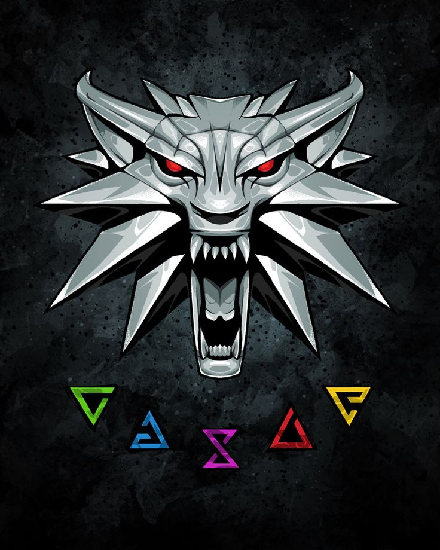

# Witcher3 Gamma Adjuster

A simple mod to adjust the gamma in **The Witcher 3: Wild Hunt (version 1.32 Classic)**.

  

  

## Installation

1. Download the latest release from the [Releases](../../releases) page.
2. Extract the downloaded archive.
3. Copy the `modGamma` folder into the game's `Mods` folder.

## Compatibility

- **Game:** The Witcher 3: Wild Hunt
- **Version:** 1.32 (Classic)
